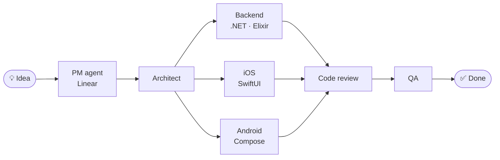

<div align="center">


<a href="https://github.com/yurii-horoshenko">
  
</a>

<br/>

[](./Yurii_Horoshenko_CV.pdf)
[](https://linkedin.com/in/yurii-horoshenko)
[](mailto:yurii.horoshenko@gmail.com)
[](https://t.me/gi_part)
[](https://argoforge.app)
[](https://visitime.net)

</div>

## 👋 About me

```swift
struct Yurii: Engineer {
    let role       = "Lead iOS / Mobile Engineer"
    let experience = "15 years · since 2011"
    let building   = ["Argoforge — a team lead for AI coding agents (argoforge.app)", "VisiTime — booking marketplace"]
    let previously = "Contactless payment SDK (EMV · NFC · Visa · Mastercard) @ Grid Dynamics"
    let stack      = ["Swift", "SwiftUI", "Kotlin Multiplatform", "Compose", ".NET", "Elixir"]
    let leadership = "Teams of 3–5 engineers · mentoring · CI/CD · architecture"
    let location   = "Wrocław, Poland 🇵🇱 · open to remote"
}
```

<table>
<tr>
<td align="center" width="25%"><h3>15</h3><sub>years in mobile</sub></td>
<td align="center" width="25%"><h3>280+</h3><sub>unit tests in a certified payment SDK</sub></td>
<td align="center" width="25%"><h3>−60%</h3><sub>app errors after VIP architecture</sub></td>
<td align="center" width="25%"><h3>−50%</h3><sub>deployment time with Fastlane</sub></td>
</tr>
</table>

## 🚀 Featured work

<table>
<tr>
<td width="50%" valign="top">

### 🧠 [Argoforge](https://argoforge.app) · Founder · [argoforge.app](https://argoforge.app)
**A team lead for your AI coding agents**

A layer on top of Claude Code and Codex: turns an agent's repeated
mistakes into rules and brings each one into the turn that needs it,
sizes the task, assembles the team of subagents, skills and MCP
servers, and tracks what every turn costs. Your code stays on your
Mac. Ten modules, a Node.js server and a native SwiftUI menu-bar
app for macOS; Starter / Pro / Team plans.
[Website](https://argoforge.app) · [How it works](https://argoforge.app/#how)

`Node.js` `Claude Code` `Codex` `Hooks` `MCP` `SwiftUI (macOS)`

</td>
<td width="50%" valign="top">

### 📅 [VisiTime](https://visitime.net) · Founder
**Booking marketplace for barbershops and salons**

Four native apps — Client and Business on **iOS (SwiftUI)**
and **Android (Compose)** — on a shared **Kotlin Multiplatform**
core. Backend on **.NET 10 + PostgreSQL** with **Phoenix
LiveView** portals and Stripe billing, co-built with a partner.

`SwiftUI` `Compose` `KMM` `Ktor` `Koin` `.NET 10` `Elixir` `Stripe`

</td>
</tr>
<tr>
<td width="50%" valign="top">

### 💳 iOS Payment SDK · Grid Dynamics <sub>2024–2026</sub>
**Enterprise SDK for contactless payments**

Host Card Emulation for NFC payments, a full EMV kernel
(TLV/BER-TLV, APDU, cryptograms, ODA, CVM), crypto on
Secure Enclave and Keychain. Multi-module SDK shipped as
XCFramework through Fastlane. **EMV L1/L2, Mastercard MCBP
and Visa VCBP certified.**

`Swift` `CryptoKit` `Secure Enclave` `NFC/HCE` `swift-testing` `Cucumber BDD`

</td>
<td width="50%" valign="top">

### 🤖 AI agent pipeline
**How VisiTime gets built**

A team of specialised agents on Claude Code works through
Linear as a task queue — product, architecture, three
platforms, review and QA — with a human deciding at
the planning and acceptance gates.

`Claude Code` `Multi-agent` `Linear` `Code review` `QA`

</td>
</tr>
</table>



## 🛠 Tech stack

<div align="center">

**Mobile**<br/>


**Backend & delivery**<br/>


<br/>


</div>

<details>
<summary><b>Full skill list</b></summary>

| Area | Skills |
|------|--------|
| **iOS** | Swift 6, SwiftUI, UIKit, Objective-C, async/await, Actors, @Observable, Combine, SwiftData, Core Data |
| **Payments & security** | EMV L1/L2, HCE/NFC, Mastercard MCBP, Visa VCBP, CryptoKit, Secure Enclave, Keychain, App Attest, PassKit, ixGuard |
| **Cross-platform** | Kotlin Multiplatform, Kotlin 2.2, Jetpack Compose, Ktor, Koin, Coroutines |
| **Backend** | C# / .NET, ASP.NET Core, PostgreSQL, Elixir / Phoenix LiveView, Stripe, REST, OpenAPI |
| **Architecture** | Clean Architecture, MVVM, VIP / VIPER, multi-module SDKs, protocol-oriented design, SOLID |
| **Delivery** | Fastlane, XcodeGen, SwiftLint, Sourcery, GitHub Actions, Jenkins, Artifactory |
| **Testing** | swift-testing, XCTest, Cucumber / Gherkin BDD, Appium |
| **AI engineering** | Claude Code, multi-agent workflows, custom skills and hooks, MCP, Cline, Aider, Copilot |

</details>

## 💼 Experience

| | Role | Company | Highlights |
|---|------|---------|------------|
| **2026 — now** | Founder · Author | [Argoforge](https://argoforge.app) | Product for AI coding agents (Claude Code, Codex) · rules from repeated mistakes · 10 modules · Node.js server · SwiftUI macOS app · paid plans |
| **2023 — now** | Founder · Lead Mobile | [VisiTime](https://visitime.net) | 4 native apps on a KMM core · .NET + Phoenix backend · AI agent pipeline |
| **2024 — 2026** | Senior iOS Developer | [Grid Dynamics](https://griddynamics.com) | Contactless payment SDK · EMV kernel · HCE/NFC · EMV, MCBP and VCBP certification · 280+ tests |
| **2023 — 2024** | Senior iOS Developer | Grid Dynamics → Transflo | Logistics and trucking platform, staff augmentation |
| **2022 — 2023** | Lead iOS Developer | Grid Dynamics | Team of 4 · SwiftUI (+30% speed) · VIP (−60% errors) · ARKit · Stripe |
| **2020 — 2022** | Lead iOS Developer | [Tranzzo](https://tranzzo.com) | OxiBank · PassKit wallet · Fastlane (−50% deploy time) · mentoring |
| **2018 — 2020** | Lead iOS Developer | [Lalafo](https://lalafo.ua) | −25% API latency · RxSwift + Realm · 8 on-time releases |
| **2011 — 2018** | iOS Developer | Infopulse · Digicode · Mobisoft · Genesis · BoostSolutions | Obj-C → Swift · Core Animation · WebRTC · XMPP · live streaming |

<div align="center">

📄 **[Download the full CV (PDF)](./Yurii_Horoshenko_CV.pdf)**

</div>

## 📱 Shipped apps

<table>
<tr>
<td align="center" width="16%"><b>Transflo</b><br><sub>Logistics</sub><br><a href="https://www.transflo.com">transflo.com</a></td>
<td align="center" width="16%"><b>Container Store</b><br><sub>E-commerce</sub><br><a href="https://apps.apple.com/us/app/the-containerstore/id1604507002">App Store</a></td>
<td align="center" width="16%"><b>OxiBank</b><br><sub>Banking</sub><br><a href="https://apps.apple.com/ua/app/oxibank/id1575737467">App Store</a></td>
<td align="center" width="16%"><b>Lalafo</b><br><sub>Marketplace</sub><br><a href="https://apps.apple.com/us/app/lalafo/id1063347253">App Store</a></td>
<td align="center" width="16%"><b>Hily</b><br><sub>Dating</sub><br><a href="https://apps.apple.com/ru/app/hily-dating-chat-meetlove/id1250946975">App Store</a></td>
<td align="center" width="16%"><b>Vethem</b><br><sub>Veterinary</sub><br><a href="https://apps.apple.com/us/app/vethem-en-digitalveterinär/id1410819467">App Store</a></td>
</tr>
</table>

<sub>Also: Kidgy (parental control), PlsPlsMe (couples), Live Auction (streaming), Stroovy (dating reviews).</sub>

---

<div align="center">

**Open to lead mobile roles, payment / fintech SDK work and AI-assisted engineering.**


</div>
